<h1 align="center"> Internship Management System</h1>

  A comprehensive, centralized enterprise web platform engineered to modernize, automate, and orchestrate the complete internship lifecycle. Developed for <b>Digital Life Agency</b>.

  
  
  
  
  
  
  

---

## Table of Contents
1. [Executive Summary & Background](#executive-summary--background)
2. [Problem Statement & Objectives](#problem-statement--objectives)
3. [Multi-Role System Architecture](#multi-role-system-architecture)
4. [Functional Modules by Actor](#functional-modules-by-actor)
   - [Candidate & Visitor Portal](#1-candidate--visitor-portal)
   - [Intern Workspace & Kanban](#2-intern-workspace--kanban)
   - [Supervisor Command Center](#3-supervisor-command-center)
   - [Administrator Central Hub](#4-administrator-central-hub)
5. [System Conception & UML Modeling](#system-conception--uml-modeling)
   - [UML Diagrams](#uml-diagrams)
   - [Use Case Specifications](#use-case-specifications)
   - [Database Relational Schema & Associations](#database-relational-schema--associations)
6. [Demo Pictures](#demo-pictures)
7. [License](#license)

---

## Executive Summary & Background

In professional and academic ecosystem, internships serve as the vital bridge connecting educational foundations with industry demands. However, managing internships across organizations has historically suffered from manual paperwork, fragmented communication channels, and disjointed progress tracking.

This project delivers a **Centralized Platform for Streamlining Internship Management Workflow**, conceived and developed for **Digital Life Agency**, a leading Tunisian agency specializing in digital transformation and enterprise web/mobile solutions.

The platform provides an end-to-end digital infrastructure that unifies offer posting, candidate application submission, document handling (CV and registration certificates), applicant evaluation, supervisor-intern project collaboration through interactive **Kanban task boards**, automated project lifecycle tracking, and instant generation of official completion certificates.

---

## Problem Statement & Objectives

### The Traditional Administrative Bottlenecks
* **Disjointed Data Silos:** Most organizations rely on disconnected spreadsheets, paper dossiers, and unorganized email threads, leading to high administrative workload and severe risk of data loss.
* **Opacity in Application Vetting:** Candidates remain in the dark regarding their application review status, while administrators face difficulties managing and filtering large volumes of candidate records.
* **Lack of Real-time Supervision:** Supervisors lack a centralized visual interface to distribute tasks, monitor deadlines, and evaluate whether intern teams are meeting their project milestones.
* **Manual Certificate Issuance:** Issuing completion certificates often requires manual document editing and repetitive administrative validation steps.

### Strategic Platform Objectives
* **Unified Application Gateway:** Enable candidates to browse opportunities by domain/technology and apply with digital credentials (CV, Registration Certificate).
* **Supervisory Telemetry & Agile Kanban:** Provide supervisors with Kanban boards to assign tasks, define priorities, set deadlines, and track real-time task progression.
* **Automated Project State Engine:** Automatically compute project status (`on going`, `completed`, or `overdue`) based on task completion and milestone dates.
* **Streamlined Administrative Controls:** Equip administrators with omniscient dashboards, candidate vetting workflows, bulk export capabilities (PDF / CSV), and instant certificate generation.
* **Enterprise Security & Reliability:** Guarantee secure role-based access control (RBAC), validated data ingestion, and high-performance server hosting.

---

## Multi-Role System Architecture

The platform is architected around five distinct actors with strictly enforced Role-Based Access Controls (RBAC):

| Actor | Primary Responsibilities | Key Capabilities |
| :--- | :--- | :--- |
| **Visitor** | Public user seeking opportunities | Browse and search internship offers, register a candidate account |
| **User (Candidate)** | Authenticated applicant | Manage profile, upload CV and registration certificate, apply for offers, track application status |
| **Intern** | Accepted student working on a project | View project metrics, manage Kanban tasks, monitor internship countdown, submit final report, download certificate |
| **Supervisor** | Project leader & mentor | Oversee assigned projects, assign interns to teams, create and prioritize tasks on Kanban boards, track weekly progress |
| **Admin** | Platform owner & director | Full CRUD on offers, supervisors, interns, and projects; review/approve/reject applications; export data (PDF/CSV); generate official certificates |

---

## Functional Modules by Actor

### 1. Candidate & Visitor Portal
* **Offer Discovery & Multi-Facet Filtering:** Filter opportunities by sector (Web Development, Mobile App, UI/UX Design, Cross-Platform), work mode (Remote, Hybrid, Onsite), and duration.
* **Digital Profile Management:** Candidate dashboard to maintain personal details, national identity (CIN), academic affiliation, and educational level.
* **Streamlined Application Pipeline:** One-click submission with CV and Registration Certificate attachment. Real-time indicators display if an offer is already applied for.
* **Live Status Tracking:** Transparent status indicators (`Pending`, `Approved`, `Rejected`).

### 2. Intern Workspace & Kanban
* **Dedicated Intern Dashboard:** Real-time metrics highlighting active projects, total assigned tasks, completed tasks, overdue tasks, and a dynamic days-remaining countdown clock.
* **Interactive Kanban Task Management:** Visual task board divided into workflow columns (`To Do`, `In Progress`, `Done`) with priority badges (`High`, `Medium`, `Low`). Interns can update task states, manage deliverables, and track deadlines.
* **Weekly Performance Analytics:** Interactive Recharts-powered bar graphs visualizing weekly task throughput (added, completed, overdue, and due).
* **Final Report Submission & Certification:** Secure portal to submit the final internship report upon completion of the duration, immediately unlocking verified internship certificate downloads.

### 3. Supervisor Command Center
* **Supervisor Overview Dashboard:** Aggregated telemetry covering all supervised projects, active team members, overall project health, and cross-project task analytics.
* **Project & Team Allocation:** Ability to update project scopes, set technical requirements, and assign or remove registered interns.
* **Task Lifecycle Oversight:** Create, assign, reprioritize, and review tasks across the Kanban boards of all supervised projects.

### 4. Administrator Central Hub
* **Executive Dashboard:** Global high-level view showing total applications, pending reviews, total active projects, completed projects, personnel counts (supervisors and interns), and offer acceptance-to-rejection ratios.
* **User & Supervisor Directory Management:** Comprehensive CRUD operations to register, edit, or decommission supervisor and intern accounts.
* **Offer Lifecycle Management:** Create and publish rich internship listings specifying sector, technology stack tags, duration, and working modality.
* **Application Review & Vetting:** Centralized review desk allowing admins to inspect submitted files, evaluate qualifications, and execute instant approval or rejection actions.
* **Bulk Export Engine:** Export complete application callsets into structured PDF or CSV formats for archiving and reporting.
* **Official Certificate Generator:** Automated document engine compiling intern credentials, project details, and supervisor validation into official PDF completion certificates.

---

## System Conception & UML Modeling

The platform was designed following the formal Unified Modeling Language (UML) standard and the Waterfall Software Engineering lifecycle.

### UML Diagrams

||||
|:---:|:---:|:---:|
||||
||||
||||

---

### Use Case Specifications

#### Textual Description of Core Execution Scenarios

* **Authenticate (UC-01):**
  - **Actors:** User, Intern, Supervisor, Admin.
  - **Pre-Condition:** The actor is already registered.
  - **Nominal Scenario:** The actor reaches the login interface, provides email and password. The system performs client-side format checks and backend verification against stored hashed credentials, redirecting to the corresponding dashboard upon validation.
  - **Alternative Scenarios:** Invalid field formats display immediate frontend error hints; incorrect credentials trigger an unauthorized alert.

* **Apply for Offer (UC-02):**
  - **Actor:** Candidate (User).
  - **Pre-Condition:** The candidate is authenticated.
  - **Nominal Scenario:** The user browses the offers catalog, opens an opportunity, fills the application form, attaches their CV and Registration Certificate, and submits. The system sequentially creates the application record (status: `Pending`) and persists uploaded documents.
  - **Post-Condition:** Offer status transitions to "Already Applied" for the applicant.

* **Change Task Status & Kanban (UC-03):**
  - **Actors:** Intern, Supervisor, Admin.
  - **Pre-Condition:** Actor is authenticated and assigned to the project.
  - **Nominal Scenario:** The actor drags or updates a task on the Kanban board (`To Do` -> `In Progress` -> `Done`). The system updates the task status in the database and evaluates project-wide completion logic: if all tasks reach `Done`, the project status automatically updates to `Completed`. If overdue, status transitions to `Overdue`.

* **Add Intern Member (UC-04):**
  - **Actors:** Supervisor, Admin.
  - **Nominal Scenario:** The supervisor selects "New Member" from the project overview, searches unassigned registered interns, selects one or more candidates, and saves. The system associates the interns with the project.

* **Export Applications (UC-05):**
  - **Actor:** Admin.
  - **Nominal Scenario:** From the applications desk, the administrator triggers "Download" and selects the desired format (PDF or CSV). The system compiles application records, candidate contacts, and offer details into a formatted file for immediate download.

* **Generate Certificate (UC-06):**
  - **Actor:** Admin.
  - **Nominal Scenario:** Upon project completion, the administrator clicks "Generate" for an intern. The system compiles intern credentials, project subject, and supervisor signatures into a tamper-proof official PDF certificate.

---

### Database Relational Schema & Associations

The persistence tier is designed with normalized third-normal-form (3NF) relational tables managed through Laravel's **Eloquent ORM**:

#### Logical Database Schema Design
* **Profiles:** `(profileId, firstName, lastName, email, cin, password, gender, phone, avatar)`
* **Users:** `(userId, educationLevel, university, #profileId)`
* **Interns:** `(internId, startDate, endDate, #userId)`
* **Supervisors:** `(supervisorId, #profileId)`
* **Admin:** `(adminId, #profileId)`
* **Offers:** `(offerId, title, description, sector, skills, duration, type, visibility)`
* **Applications:** `(applicationId, startDate, endDate, status, motivationLetter, #offerId, #userId)`
* **Projects:** `(projectId, subject, description, startDate, endDate, status, priority, #supervisorId)`
* **Project_intern:** `(projectInternId, #projectId, #internId)`
* **Tasks:** `(taskId, title, description, dueDate, priority, status, #internId, #projectId)`
* **Emails:** `(emailId, email, fullName, subject, message)`
* **Files:** `(fileId, url, fileType, #fileable_id)`

#### System Associations & Multiplicities

| Designation | Participating Classes | Multiplicity | Description |
| :--- | :--- | :---: | :--- |
| **Submit** | User & Application | `1` to `0..*` | A registered candidate can submit zero or multiple applications |
| **Manage** | Admin & Email | `1` to `0..*` | An administrator reviews and manages platform emails |
| **Supervise** | Supervisor & Project | `1` to `0..*` | A supervisor oversees zero or multiple company projects |
| **Assign** | Intern & Project | `0..*` to `0..*` | Interns can be assigned across active projects (many-to-many) |
| **hasApplications** | Offer & Application | `1` to `0..*` | An internship offer receives multiple candidate applications |
| **hasTasks** | Project & Task | `1` to `0..*` | A project contains multiple actionable Kanban tasks |
| **hasFiles** | Application & File | `1` to `2` | Each application record securely links to two files (CV & Certificate) |

---

## Demo Pictures

|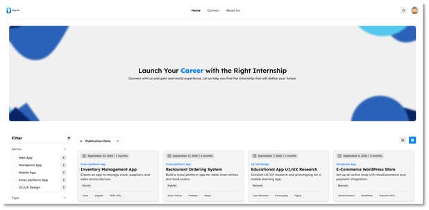|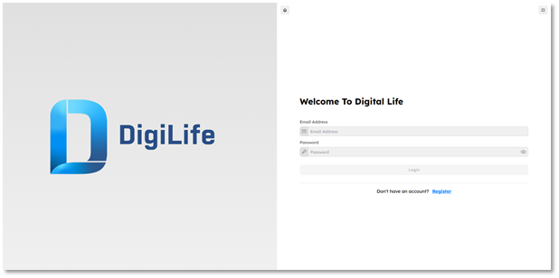|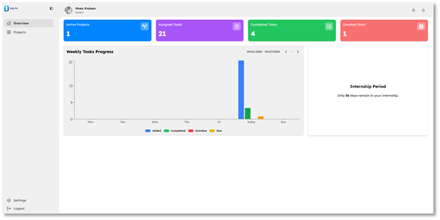|
|:---:|:---:|:---:|
|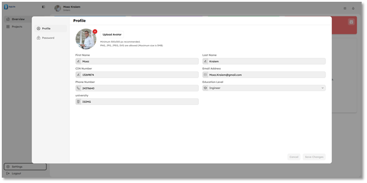|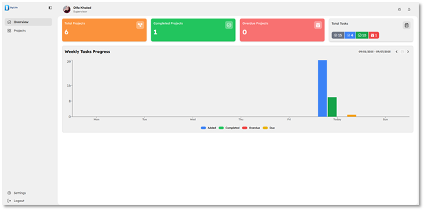|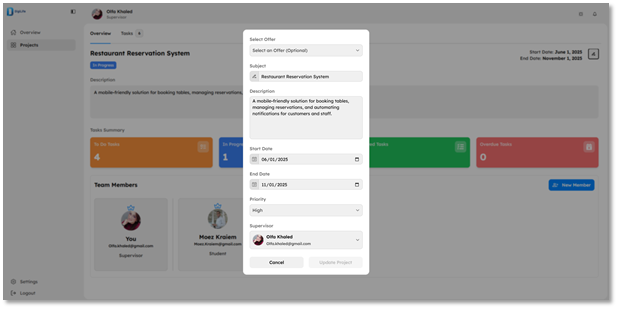|
|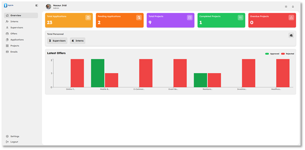|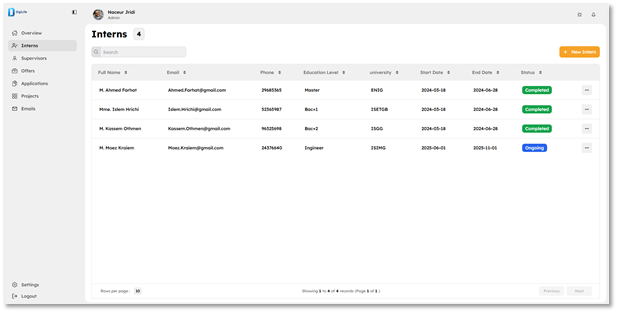|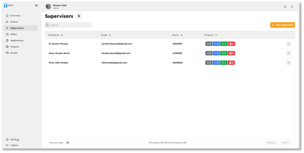|
|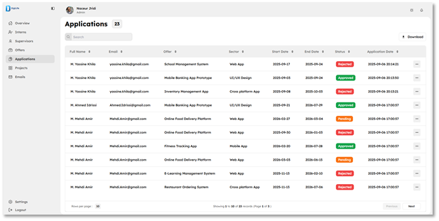|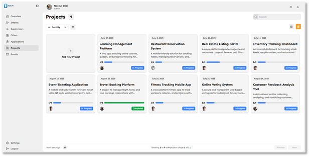|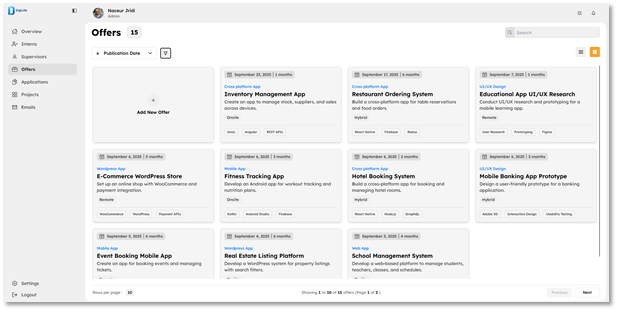|

---

## License

This project is licensed under the [MIT License](LICENSE).
